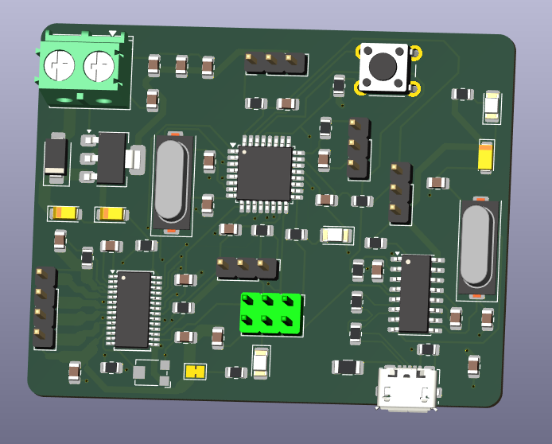
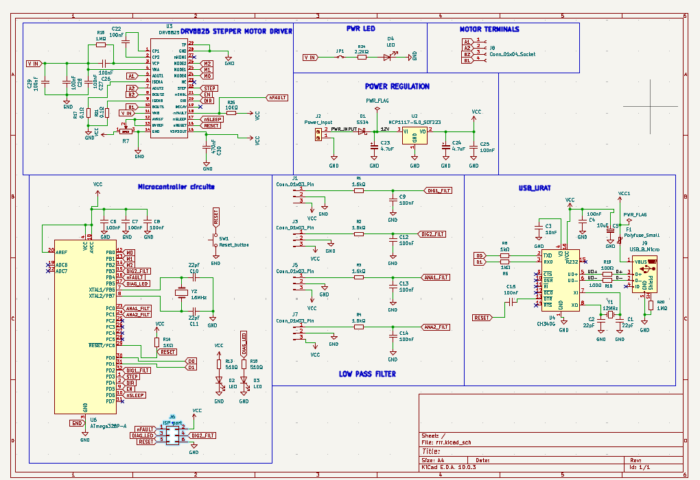
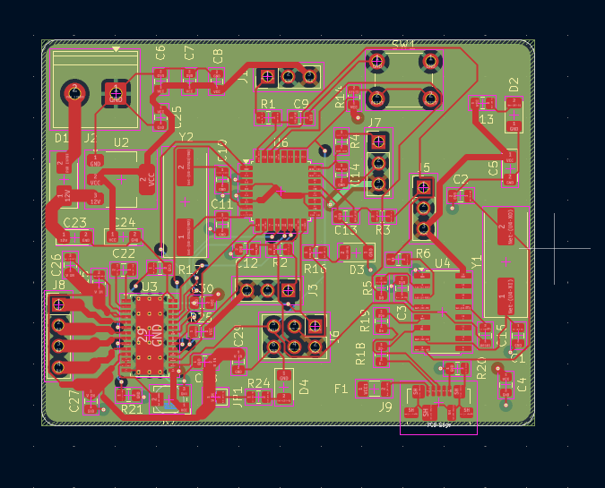
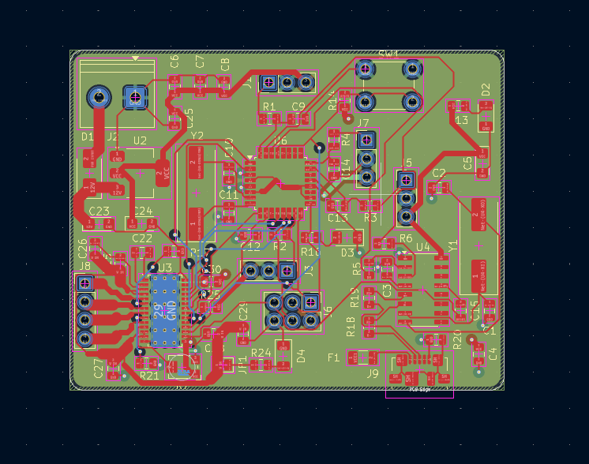

<div align="center">

# Stepper Motor Controller PCB

**An Arduino-compatible stepper motor controller board: ATmega328P + DRV8825 on a compact 4-layer PCB**




</div>

---

## Table of Contents
- [Overview](#overview)
- [Key Features](#key-features)
- [Specifications](#specifications)
- [Schematic](#schematic)
- [PCB Layout](#pcb-layout)
- [Getting Started](#getting-started)
- [Project Structure](#project-structure)
- [Future Work](#future-work)
- [Author](#author)

## Overview
A single-board solution for driving a bipolar stepper motor. It combines a microcontroller, a USB interface, a stepper driver and power conditioning on one 60 × 47 mm PCB. Because the board is Arduino Uno compatible, it can be programmed from the Arduino IDE over USB. Typical uses include small CNC axes, 3D-printer-style mechanisms, camera sliders and robotic joints.

## Key Features
- **ATmega328P** microcontroller with a 16 MHz crystal, reset button and ISP header for bootloader flashing.
- **DRV8825 stepper driver**:
  - Up to 1/32 microstepping
  - Adjustable current limit through the on-board potentiometer
  - 4-pin motor output terminal
- **USB-to-UART** through a CH340G and a Micro-USB connector, for programming and serial communication.
- **Robust power input**:
  - Screw terminal for the motor supply
  - SS34 Schottky diode for reverse-polarity protection
  - NCP1117 5 V LDO regulator
  - Resettable polyfuse on USB
- **4 filtered analog inputs** on 3-pin headers, each with an RC low-pass filter (1.6 kΩ / 100 nF, fc ≈ 1 kHz) for clean sensor readings.
- **Power and indicator LEDs.**

## Specifications
| Parameter | Value |
|-----------|-------|
| Board size | 60 × 47 mm, rounded corners |
| Layer stack | 4 layers: F.Cu / In1.Cu / In2.Cu / B.Cu |
| Component count | 63 footprints, mostly SMD |
| Microcontroller | ATmega328P-A (TQFP-32) @ 16 MHz |
| Motor driver | TI DRV8825 |
| USB bridge | WCH CH340G |
| Logic supply | 5 V (NCP1117-5.0) |
| EDA tool | KiCad 10 |

## Schematic


The design is organized into clearly separated functional blocks:

| Block | Main components | Function |
|-------|-----------------|----------|
| Stepper motor driver | DRV8825, sense resistors, bulk capacitors | Drives the stepper coils with current regulation |
| Power regulation | NCP1117-5.0, SS34, filter capacitors | Protected 5 V logic rail |
| Microcontroller | ATmega328P-A, 16 MHz crystal, reset, ISP | Control logic |
| USB / UART | CH340G, Micro-USB, polyfuse | Programming and serial link |
| Low-pass filters | 4 × RC networks | Sensor signal conditioning |

## PCB Layout
| Front copper | All layers |
|:---:|:---:|
|  |  |

Layout notes:
- The 4-layer stack-up has copper pour zones on the inner layers (In1.Cu / In2.Cu), with signal routing mainly on the top layer.
- Most components are SMD on the top side, which keeps assembly single-sided.
- The power input, motor terminal, USB and sensor headers are placed along the board edges for easy cabling.

## Getting Started
1. Install [KiCad](https://www.kicad.org/) 10 or newer.
2. Clone the repository:
   ```bash
   git clone https://github.com/abdallahnafady54321-bit/stepper-motor-controller-pcb.git
   ```
3. Open `hardware/stepper_controller.kicad_pro`.
4. The custom **DRV8825** symbol lives in `hardware/my_project_lib.kicad_sym`, and the included `sym-lib-table` links it automatically.

**Manufacturing:** generate Gerber and drill files from the PCB editor (*File → Fabrication Outputs*). The board can be ordered from any standard 4-layer PCB service.

## Project Structure
```
stepper-motor-controller-pcb/
├── hardware/
│   ├── stepper_controller.kicad_pro   # KiCad project
│   ├── stepper_controller.kicad_sch   # Schematic
│   ├── stepper_controller.kicad_pcb   # PCB layout
│   ├── my_project_lib.kicad_sym       # Custom DRV8825 symbol
│   └── sym-lib-table                  # Project symbol library table
└── images/                            # Renders and screenshots
```

## Future Work
- Add jumpers for selecting the microstepping mode and break out the DRV8825 FAULT pin.
- Add limit-switch inputs with optional optical isolation.
- Assemble a prototype and validate it with firmware, for example AccelStepper.

## Author
**Abdallah Yasser**, Mechatronics Engineering
[GitHub](https://github.com/abdallahnafady54321-bit)

## License
This project is licensed under the MIT License. See [LICENSE](LICENSE) for details.
